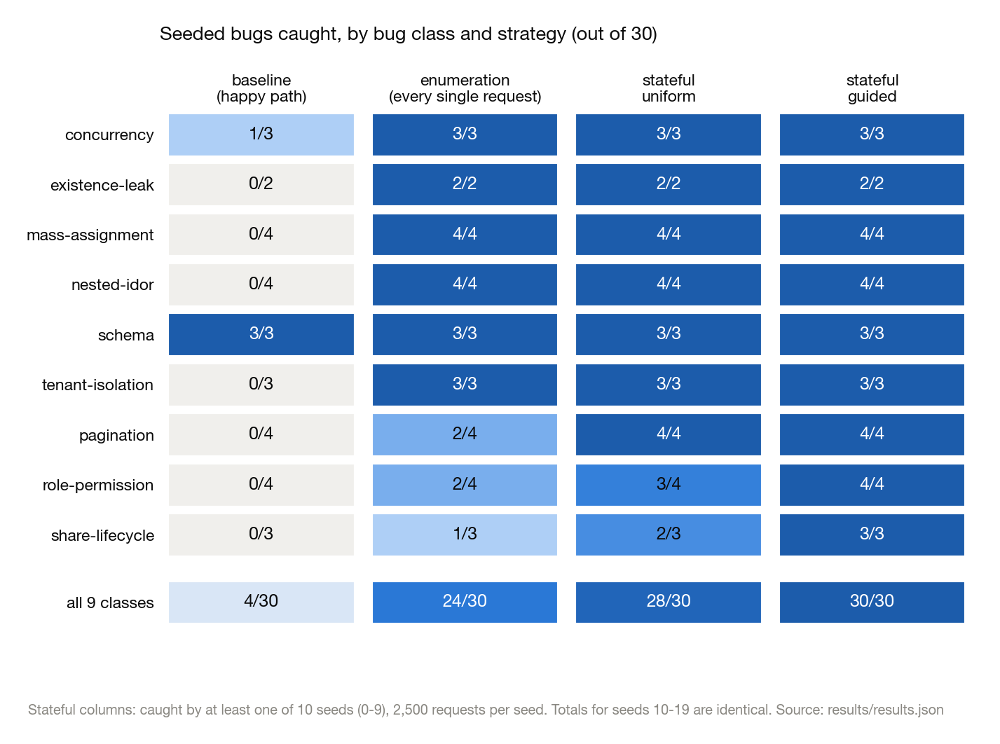
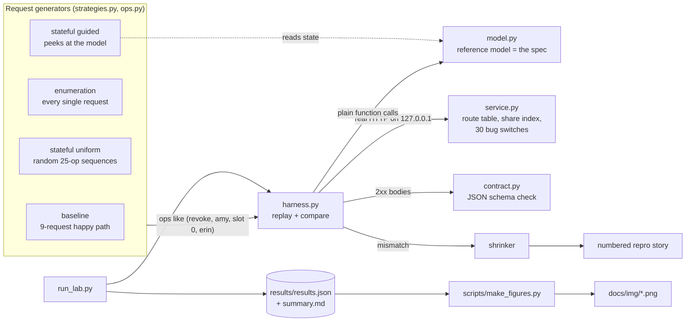
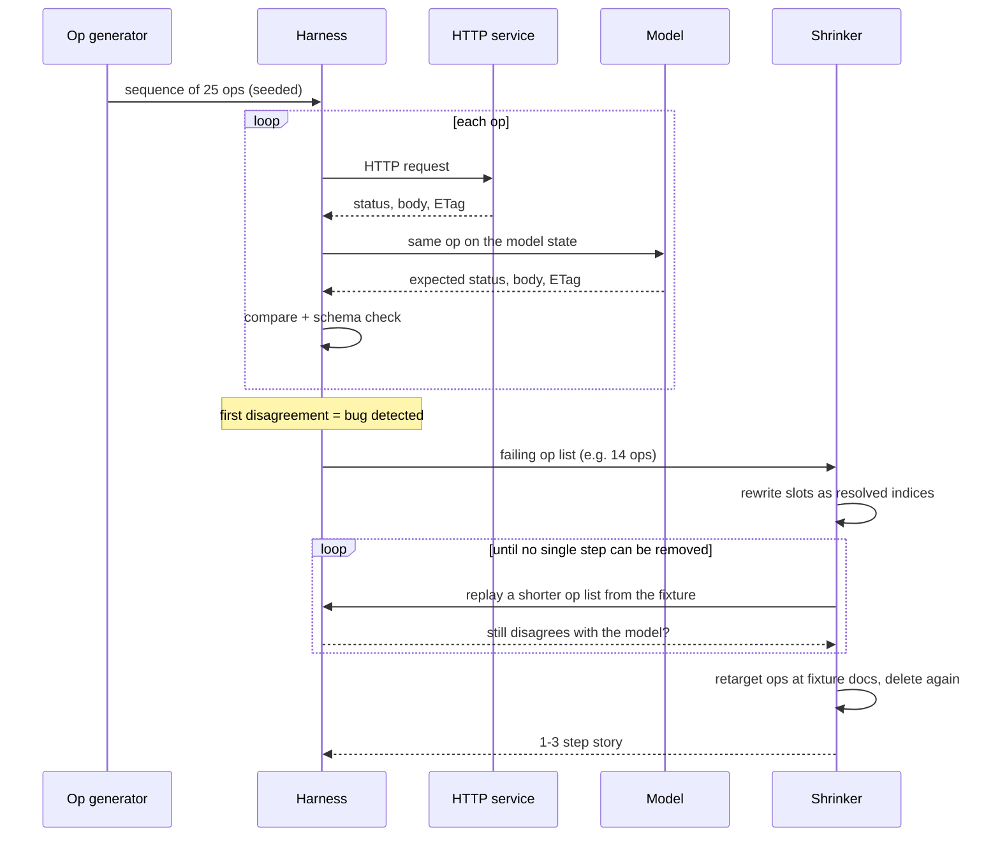
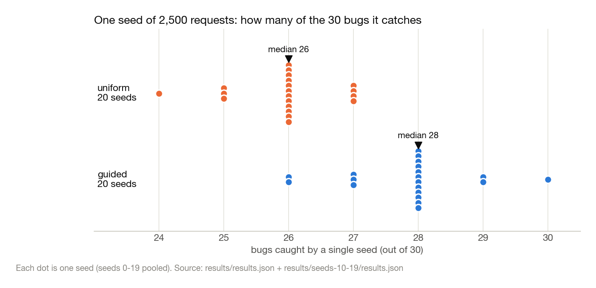
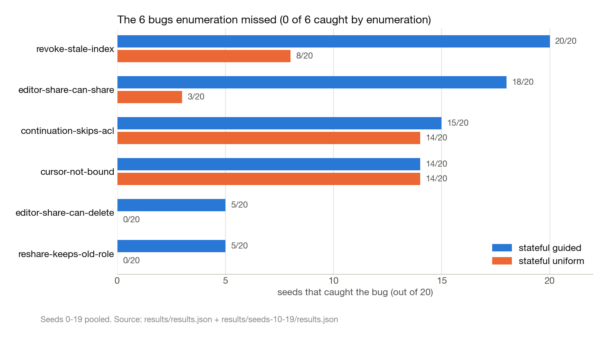
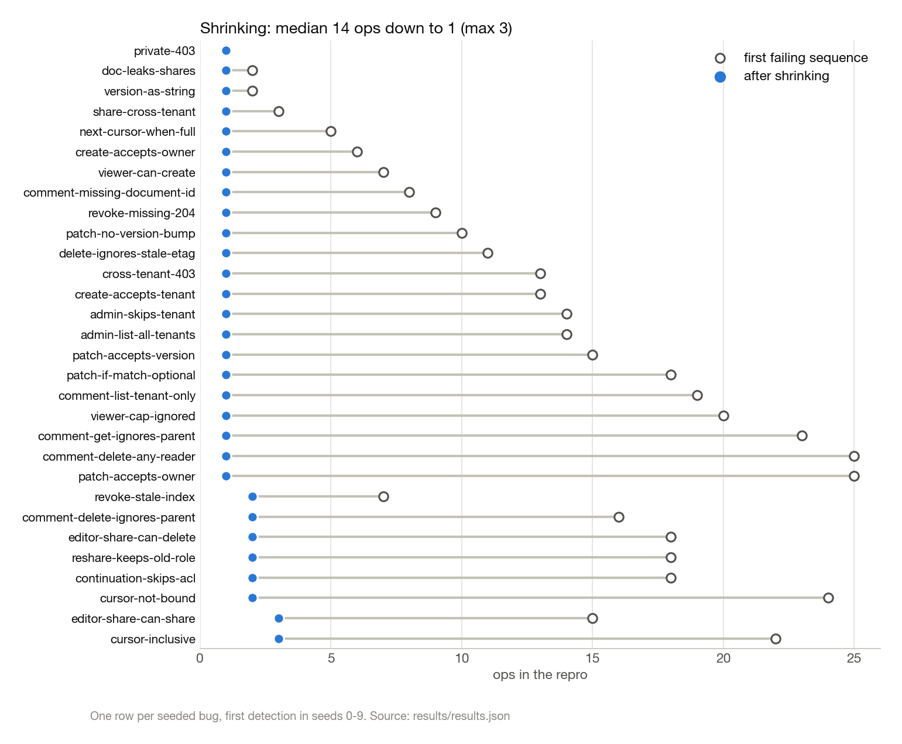

# API authorization regression lab

**I hid 30 authorization bugs in a tiny API and measured which way of testing it actually finds them.**

A tiny document-sharing API, a pure-Python model of what it *should* do, and
three different ways of throwing requests at both to see where they disagree.
Python 3.10+, standard library only, everything on `127.0.0.1`.

### TL;DR

- **Bugs caught, out of 30 seeded:** happy-path baseline **4**, exhaustive
  single-request enumeration **24**, stateful random sequences **28**
  (uniform) and **30** (guided). Same totals for seeds 0–9 and 10–19.
- **The clean service never disagreed with the model:** 0 mismatches across
  3 enumeration runs of 1,962 requests and 50,000 stateful requests.
- **One guided seed of 2,500 requests caught 26–30 of 30** across 20 seeds
  (median 28). One uniform seed caught 24–27 (median 26).
- **Every failure shrank to a 1–3 step story** (median 1) from a median of
  14 ops, so a bug report reads like "amy revokes erin's share, then erin
  lists documents".



## The bug that made me build this

The first version of this repo had a big contract test: every user × every
document × GET/PATCH/DELETE, 379 checks, all green. Then I wondered about this
sequence:

```
1. amy revokes erin's share on d001 -> 204
2. erin lists documents (limit=3) -> 200   <-- service disagrees with model
   items ['d001'], model says []
```

Erin can't *open* d001 any more (GET is 404), but it still shows up in her
list, because the list endpoint reads a separate "shared with me" index that
revoke forgot to update. Every single request in that story is something my
old suite already sent. It just never sent them **in that order**. A
"check every cell of the permission table" suite can't see bugs that only exist
between two requests.

That story above isn't hand-written. It's the actual output of the shrinker
for the `revoke-stale-index` bug, cut down from a 7-step random sequence.

## Architecture



## What I built

- **A small multi-tenant API** (`service.py`, ~430 lines, `http.server` with
  keep-alive): two tenants, eight users with roles viewer / editor / admin,
  private-by-default documents, shares, nested comments
  (`/documents/{id}/comments/{cid}`), cursor pagination where cursors are
  tied to the user they were issued to, `If-Match` on PATCH/DELETE (428 if
  missing, 412 if stale), strict request bodies (sending `owner` or `tenant`
  gets a 400), and 404-not-403 when you can't read something, so you can't
  probe for what exists.
- **A reference model** (`model.py`, ~240 lines): the same policy written as a
  state machine with no HTTP, no threads and no shared code with the service.
  It is the oracle for every strategy, so the only difference between
  strategies is *which requests they choose*.
- **30 seeded bugs** (`mutations.py`): one-line code faults behind
  `if self.bug("name")` switches, in 9 classes: tenant isolation, existence
  leaks (403 instead of 404), role checks, share lifecycle, nested-resource
  IDOR, pagination, mass assignment, ETag/concurrency, and response schema.
- **Three strategies** (`strategies.py`), stateful in two flavours:

  | strategy | what it sends |
  | --- | --- |
  | baseline | 9-request owner happy path: create, get, patch, list, comment, delete |
  | enumeration | every single request from the fixture state, with a reset between cases: 9 principals × 5 documents × every endpoint, stale/missing ETags, extra-field bodies, paging (1,962 requests) |
  | stateful (uniform) | seeded random sequences of 25 ops, arguments drawn uniformly |
  | stateful (guided) | same, but the generator peeks at the model to choose plausible arguments: documents in your tenant, grants that actually exist, people involved with the doc |

- **A shrinker and story printer** (`harness.py`) that turns a failing random
  run into the shortest numbered story it can find.
- **An evaluation runner** (`run_lab.py`) that runs the clean service and every
  bug × every strategy, and writes `results/results.json` + `summary.md`.

## How it works

**Ops reference things by "slot"**, not by id. `("get", "alice", 7)` means
"the 7th document ever created, modulo how many exist". That makes any
subsequence of a failing run still replayable, which is what makes shrinking
work.

For every op, the harness sends the real HTTP request, applies the same op to
the model, and compares status code, body (for lists: the item ids plus
whether `next_cursor` is present) and `ETag`. 2xx bodies also get a JSON
schema check from `contracts/documents.json`. The first disagreement stops the
run, and the shrinker takes over:



The shrinker does a delta-debugging-style deletion pass, then tries pointing
ops at fixture documents so unneeded `create` steps can go, then deletes
again. The result is locally minimal (no single step can be removed), not
guaranteed globally minimal.

## Results

`python3 run_lab.py` on an Apple M2 (Python 3.10.8), seeds 0–9, 2,500
requests per stateful seed. I re-ran with seeds 10–19 to check the spread.
Full tables are in [`results/summary.md`](results/summary.md), the raw data
is in [`results/results.json`](results/results.json)
(+ [`results/seeds-10-19/`](results/seeds-10-19/)), and the method is written
up in [`docs/EVALUATION.md`](docs/EVALUATION.md). Every chart below is drawn
by [`scripts/make_figures.py`](scripts/make_figures.py) straight from those
JSON files.

**Clean service:** 0 disagreements with the model across 3 enumeration runs
(1,962 requests each) and 50,000 stateful requests (2 modes × 10 seeds ×
2,500). Same for seeds 10–19.

**Bugs caught** (stateful = caught by at least one of the 10 seeds; identical
totals for seeds 0–9 and 10–19):

| class | bugs | baseline | enumeration | stateful uniform | stateful guided |
| --- | ---: | ---: | ---: | ---: | ---: |
| tenant-isolation | 3 | 0 | 3 | 3 | 3 |
| existence-leak | 2 | 0 | 2 | 2 | 2 |
| role-permission | 4 | 0 | 2 | 3 | 4 |
| share-lifecycle | 3 | 0 | 1 | 2 | 3 |
| nested-idor | 4 | 0 | 4 | 4 | 4 |
| pagination | 4 | 0 | 2 | 4 | 4 |
| mass-assignment | 4 | 0 | 4 | 4 | 4 |
| concurrency | 3 | 1 | 3 | 3 | 3 |
| schema | 3 | 3 | 3 | 3 | 3 |
| **all** | **30** | **4** | **24** | **28** | **30** |

That "30" is the union of 10 seeds, which flatters the stateful columns. The
fairer comparison is one seed at a time:



**A single guided seed (2,500 requests) caught 26–30 of 30** across all 20
seeds I ran (median 28). A single uniform seed caught 24–27 (median 26).

The six bugs enumeration missed, with all 20 seeds pooled:



| bug | uniform: seeds that caught it | guided: seeds that caught it | guided median requests to catch |
| --- | ---: | ---: | ---: |
| revoke-stale-index | 8/20 | 20/20 | 346.5 |
| editor-share-can-share | 3/20 | 18/20 | 977.5 |
| continuation-skips-acl | 14/20 | 15/20 | 756 |
| cursor-not-bound | 14/20 | 14/20 | 458.5 |
| editor-share-can-delete | 0/20 | 5/20 | 1118 |
| reshare-keeps-old-role | 0/20 | 5/20 | 1116 |

**Shrinking:** every one of the 30 detections shrank to a story of 1–3
steps (median 1) from a median of 14 steps (seeds 0–9: 22 one-step, 6
two-step, 2 three-step; seeds 10–19: 21 one-step, 9 two-step, from a median
of 13.5). The two-step ones are the fun ones, like "dave lists with limit=1,
then amy uses dave's cursor".



The whole evaluation took 104 s wall-clock with 4 worker processes. The
second run took 384 s because the machine was busy with other jobs (load
average around 100). `results.json` records the load average at start.

### What the numbers do NOT show

- **Coverage of bugs I didn't seed.** The 30 faults are hand-written, one per
  switch, in classes I chose. 30/30 means the strategies catch *these* faults.
- **That the spec is right.** The model and service share authors, so a
  shared misunderstanding is invisible to every column above.
- **That contract tests can't find multi-step bugs.** Enumeration's misses
  come from its definition (single requests from one fixture) and from the
  fixture's gaps. A human writing a "revoke then list" scenario would catch
  `revoke-stale-index` too.
- **Anything about other budgets.** Stateful rates are tied to 2,500 requests
  per seed, these 20 seeds and these generator weights. Some bugs are caught
  in only 5/20 seeds.
- **Performance.** Wall-clock times are noisy (the machine was heavily loaded)
  and detection results don't depend on timing.

## What surprised us

- **Enumeration missed two bugs for a dumb reason.** `editor-share-can-delete`
  isn't a multi-step bug at all. The fixture just has no *editor-role* user
  holding an *editor* share (both editor shares go to viewers). "Every user ×
  every doc" is only as good as the fixture. Adding one line
  (`"d003": {"bob": "editor"}`) makes enumeration catch it. There's a test
  for exactly that (`test_fixture_gap_...`).
- **Uniform random was worse than I expected.** It never caught
  `editor-share-can-delete` or `reshare-keeps-old-role` in 20 seeds. Both
  need "share X with an editor-role user as editor, then that user does
  something", and picking that by chance from 1,000 slots × 8 users is rare.
  Letting the generator look at the model (pick live docs in my tenant, revoke
  grants that exist) fixed `revoke-stale-index` from 8/20 to 20/20.
- **Guided isn't strictly better.** For `cursor-not-bound` both modes caught it
  in 14/20 seeds, and in seeds 10–19 uniform actually caught it more often
  (9/10 vs 7/10). Biasing toward "plausible" arguments also means fewer weird
  ones.
- **v1's "60/60" was misleading-ish.** The old mutation set had 40 auth
  "variants" that were really one bug per table cell, which made a
  table-walking test look perfect. Switching to 30 real code faults (one
  switch each, in different code paths) made the comparison honest.
- **Most bugs are one request away.** 22 of 30 shrank to a single request
  (21 with seeds 10–19). All six bugs enumeration missed shrank to 2–3 steps,
  which is the whole point: they only exist *between* requests (or, for the
  two role bugs, in a state the fixture never sets up).

## Run it yourself

**Prerequisites:** Python 3.10+. Nothing to install for the lab itself
(standard library only). The figure script additionally needs `matplotlib`.

**Setup:**

```sh
git clone https://github.com/nikhils23j/api-contract-authorization-regression.git
cd api-contract-authorization-regression
```

**Quickstart** (one bug, with its shrunk story):

```sh
python3 run_lab.py --only revoke-stale-index --story --seeds 3
python3 run_lab.py --quick        # 3 seeds x 600 requests, what CI runs; writes nothing
```

**Full evaluation** (writes `results/results.json` + `results/summary.md`):

```sh
python3 run_lab.py                                            # seeds 0-9, 4 workers
python3 run_lab.py --seed-start 10 --out results/seeds-10-19  # seeds 10-19
python3 scripts/make_figures.py                               # redraw docs/img/*.png from the JSON
```

Expected runtime: the seeds 0–9 run took 103.6 s wall-clock on an M2 with 4
workers, the seeds 10–19 run 383.5 s on a heavily loaded machine.
`run_lab.py` exits non-zero if the *clean* service disagrees with the model
anywhere.

### How to break it yourself

1. Pick a check in `src/aclreg/service.py` and add a switch, e.g. in
   `post_comment`:
   ```python
   if not self.bug("viewer-cannot-comment"):
       self.load_readable(who, doc)
   ```
2. Register it in `src/aclreg/mutations.py`:
   `Mutation("viewer-cannot-comment", "nested-idor", "...")`.
3. `python3 run_lab.py --only viewer-cannot-comment --story --seeds 5`
   and see which strategies notice, and what the shrunk story looks like.

Or change the *spec*: edit a rule in `model.py` without touching the service,
and the clean run should immediately fail with a story showing you where
they now disagree.

## Tests

```sh
python3 -m unittest discover -s tests -v     # 17 tests
```

17 tests in `tests/test_lab.py`, 2.0 s in my latest run on an M2 (about 12 s
when the machine was loaded):

- **Model policy (6):** read/write/manage rules, 404-vs-403, `If-Match`
  preconditions and strict bodies, cursor paging and user binding, nested
  comments must belong to the path document, revoke removes visibility.
- **Real HTTP service (3):** status codes, headers and schema over a real
  socket; unknown bug names are rejected; the clean service agrees with the
  model under every strategy.
- **Mutations (5):** catalogue shape, every class has a bug enumeration
  catches, the stale share index needs two steps, the one-line fixture gap
  fix, stateful runs are deterministic per seed.
- **Shrinker (3):** removes noise and prints a story, drops unneeded
  `create` steps, canonical form is equivalent to the original.

`.github/workflows/check.yml` runs the unit tests and `run_lab.py --quick` on
push.

## Project layout

```
.
├── contracts/documents.json    fixture: users, docs, shares, comments, response schemas
├── src/aclreg/
│   ├── model.py                reference model (the spec)
│   ├── service.py              HTTP service + 30 bug switches
│   ├── mutations.py            bug catalogue
│   ├── ops.py                  op language, random generators, slot resolution
│   ├── harness.py              run service vs model, compare, shrink, stories
│   ├── strategies.py           baseline / enumeration / stateful
│   ├── client.py               keep-alive HTTP client
│   └── contract.py             fixture loading + JSON schema checks
├── run_lab.py                  evaluation -> results/results.json + summary.md
├── results/                    saved results (seeds 0-9, and seeds-10-19/)
├── scripts/make_figures.py     README charts, read only from results/
├── docs/
│   ├── EVALUATION.md           method and numbers in more detail
│   └── img/                    generated charts
└── tests/test_lab.py           17 unit + integration tests
```

## What this isn't / limits

- **Not a security assessment of anything real.** It's a ~430-line toy API I
  wrote, on localhost, with in-memory data.
- **The bugs are mine.** 30 seeded faults in 9 classes that I thought of. A
  high catch rate here says the strategies catch *these* faults, not that
  they'd catch real-world vulnerabilities I didn't imagine.
- **The model and the service were written by the same people (me + AI).** If
  we misunderstood a rule in the same way in both, nothing here would notice.
  The JSON schema check is a small independent cross-check, nothing more.
- **Enumeration loses on multi-step bugs by definition.** It's "one request
  from the fixture state". A human writing a scenario test for "revoke then
  list" would catch that bug too. The point is that random sequences find it
  without anyone thinking of the scenario.
- **Stateful numbers depend on budget and seeds.** At 2,500 requests per seed
  some bugs are caught in only 5/20 seeds. More budget would raise that.
  Fewer would lower it.
- No Selenium, no SAST/DAST, no CI pipeline beyond a GitHub Actions file that
  runs the unit tests and `--quick`.

## More

- [`docs/EVALUATION.md`](docs/EVALUATION.md): the evaluation method in detail.

I've read and re-run everything here, and the numbers above come from my own runs.
